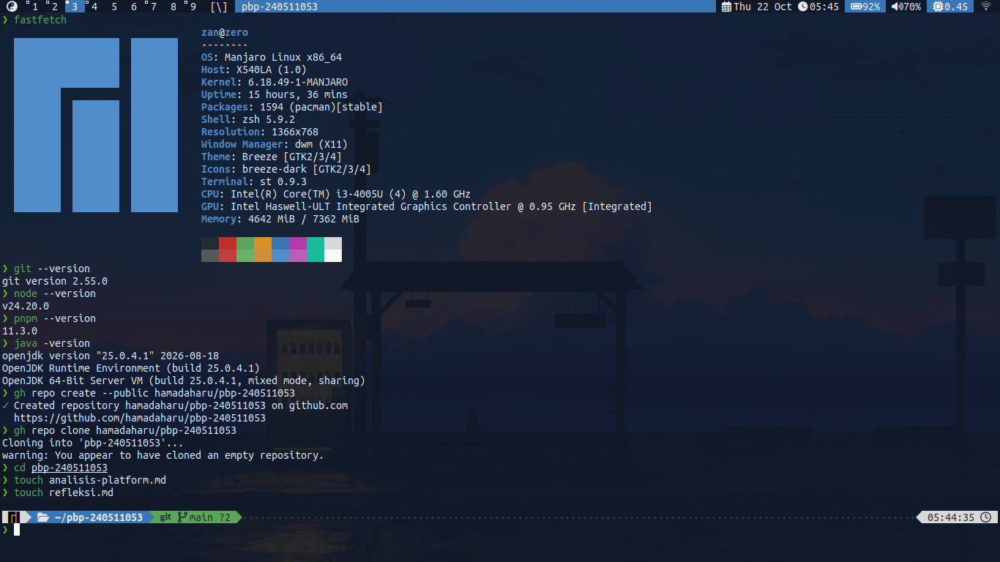

# Pemrograman Berbasis Platform

Repository ini dibuat untuk memenuhi tugas mata kuliah **Pemrograman Berbasis Platform**.

## Identitas Mahasiswa

- **Nama**: Muhammad Rozaan
- **NIM**: 240511053
- **Kelas**: TI24B

---

## Environment & Versi Perangkat Lunak (Tools Version)

Berikut adalah informasi lingkungan pengembangan dan versi *tools* yang digunakan:

### Rincian Versi:
- **Sistem Operasi**: Manjaro Linux x86_64 (Kernel 6.18.49-1-MANJARO)
- **Git**: 2.55.0
- **Node.js**: v24.20.0
- **pnpm**: 11.3.0
- **Java (OpenJDK)**: 25.0.4.1
